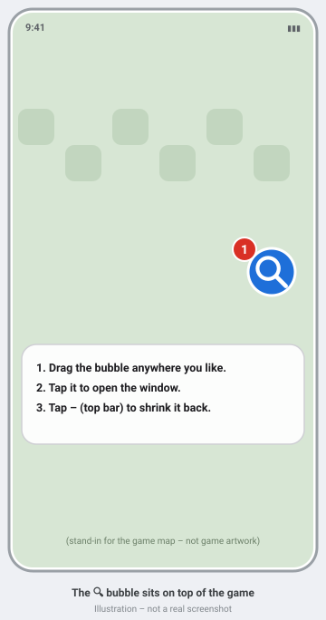
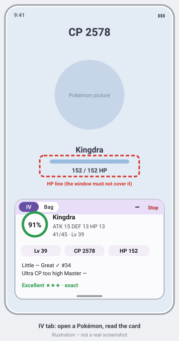
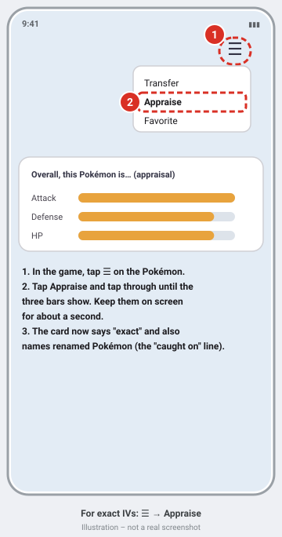
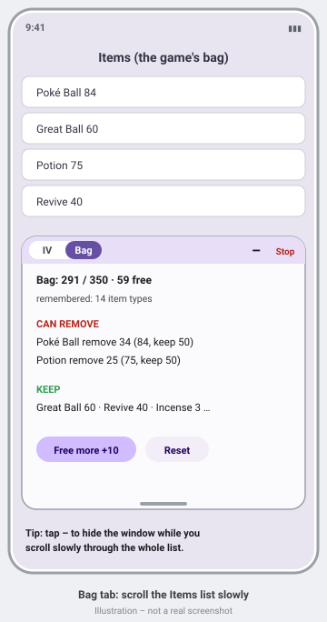

# Trainer Lens 🔍

[](https://github.com/PremKishore27/trainer-lens/actions/workflows/build-apk.yml)
[](https://github.com/PremKishore27/trainer-lens/releases/latest)
[](https://github.com/PremKishore27/trainer-lens/releases)
[](LICENSE)


**Check any Pokémon's IVs and PvP rank, and see what to throw out of your bag – without leaving Pokémon GO.**
A small movable window floats on top of the game and reads your screen with on-device text recognition.

- 📊 **IV checker** – open a Pokémon: IV %, Attack / Defense / HP, level and Great / Ultra / Master League rank. Appraise it for exact numbers.
- 🎒 **Bag advisor** – scroll your Items once and it tells you what you can discard, and what to keep.
- 🛡️ **Read-only and private** – it never taps, swipes or talks to the game's servers, and your screen is processed on your phone and thrown away. No account, no ads, free.

### ⬇️ [Download the latest APK](https://github.com/PremKishore27/trainer-lens/releases/latest/download/TrainerLens.apk)

Android 8.0+ · free · open source (MIT) · [step-by-step install guide](#install) · [what's new](CHANGELOG.md)
<sub>💬 Questions or ideas? [Open an issue](https://github.com/PremKishore27/trainer-lens/issues/new/choose) · ☕ [Support on Ko-fi](https://ko-fi.com/premboii) · 🤖 [Built with AI assistance](#about-this-project)</sub>

### See how it works

<table>
<tr>
<td align="center" width="25%"><br><sub><b>1.</b> Drag the 🔍 bubble, tap to open</sub></td>
<td align="center" width="25%"><br><sub><b>2.</b> Open a Pokémon: IV and PvP card</sub></td>
<td align="center" width="25%"><br><sub><b>3.</b> Appraise for exact IVs</sub></td>
<td align="center" width="25%"><br><sub><b>4.</b> Bag: what to discard</sub></td>
</tr>
</table>

<sub>These are drawn illustrations of the screens, not real screenshots (no game artwork is used). Real screenshots are coming.</sub>

**New here?** Follow the **[step-by-step walkthrough with pictures](docs/WALKTHROUGH.md)** – every setup tap explained, including the *Restricted setting* trap.

**Jump to:** [Features](#features) · [Install](#install) · [Using it](#using-it) · [Troubleshooting](#troubleshooting) · [Privacy](#privacy--permissions) · [FAQ](#faq) · [Build from source](#build-from-source) · [Contributing](#contributing)

---

## Features

| | Feature | What it shows |
|---|---|---|
| 🖐️ | **Movable glass overlay** | A 🔍 bubble you can drag anywhere. Tap it for one fixed-size, frosted-glass window with **IV** and **Bag** tabs – it never resizes, whichever Pokémon you open. Drag it by its top bar; the bubble and the window each remember their own spot. **Drag the bottom edge** of the window to resize it to any size you like (it remembers the size). |
| 🧭 | **Guided hints** | If you're on the wrong screen, the card says so with a small drawing: *Go to your Item bag* on the Bag tab, *Open a Pokémon* (or *Wrong screen – you're in the Item bag*) on the IV tab. |
| 🎒 | **Bag advisor** | Remembers your items for the whole session while you scroll. Shows free slots, what you **can remove** (over your keep limit) and what to **keep** – even when the bag isn't full. When it is full, it tells you exactly what to discard to free the slots you want. |
| 📊 | **IV checker** | Open any Pokémon with the IV tab selected. **Appraise it for exact IVs** – the app measures the appraisal bars like Poké Genie. The card shows **IV %**, appraisal **stars**, the **Attack / Defense / HP** spread, estimated **level**, and **Little / Great / Ultra League rank**. |
| 🌍 | **Nicknames & regional forms** | Finds the species from its candy label, types, size and EVOLVE button – never from the name alone – so renamed Pokémon and Alolan / Galarian / Hisuian forms work. Shows **"Not it?"** buttons when two species fit. If a Pokémon still can't be identified, **appraise it**: the *"This … was caught on …"* line on that screen names it and the app picks it up by itself. |
| ⚡ | **Fast swiping** | A new Pokémon is shown from the first frame it's read (marked *reading…*) and confirmed on the next; heavy work runs in the background. **Copy log** shows how long OCR and analysis took on your phone. |
| 🎯 | **Level arc** | Reads the white dot on the level arc (like Poké Genie) and calibrates itself to your phone. |
| ✅ | **Tested on every Pokémon** | Each build checks ~76,000 cases across all 1,168 forms against the game data. |
| ✨ | **Shadow / purified / lucky** | Understands their different stardust costs. |
| 🔄 | **Always up to date** | Base stats are loaded from the [pogoapi.net](https://pogoapi.net) community database, so new Pokémon work without an app update. |

### Example IV card

```
Kingdra                         nickname
 ( 91% )  ATK ▬▬▬▬▬▬▬ 15
 ( 41/45) DEF ▬▬▬▬▬▬  13
          HP  ▬▬▬▬▬▬  13
[ Lv 39 ] [ CP 2578 ] [ HP 152 ]
Little —          Great  —
Ultra  CP too high  Master —
Excellent ★★★ · exact
```

The ring and bars are green for a great Pokémon (top-100 PvP rank or ≥ 91 %), amber for decent, red for weak.
League rows: ✓ = top 100 of 4,096 spreads, ? = maybe (depends on the exact IVs), ✗ = not good, *CP too high* = already past that league's cap.
The overlay hides itself from its own screen reading (its area is blacked out before text recognition), so it can't misread its own numbers.
How the numbers are calculated (formulas, tables, worked example): **[docs/IV-CALCULATIONS.md](docs/IV-CALCULATIONS.md)**.

---

## Install

Trainer Lens isn't on the Play Store, so Android shows a few extra safety prompts. **They're all expected.**

1. **Download** [`TrainerLens.apk`](https://github.com/PremKishore27/trainer-lens/releases/latest/download/TrainerLens.apk) on your phone and open it.
   If asked, allow your browser / Files app to **install unknown apps**.
2. **Google Play Protect** may offer to scan the app → tap **Install without scanning** (or let it scan).
3. Open Trainer Lens and do the steps **in order**:

   | Step | What to do | Why it's needed |
   |---|---|---|
   | 1 | **Allow** notifications | Android requires a notification while the screen is being read |
   | 2 | **Allow** *Display over other apps*: pick Trainer Lens and switch it on | Shows the 🔍 bubble on top of the game |
   | 3 | **Only if step 2 was blocked** (it says *Restricted setting*, or the switch is greyed out): tap **OK**, go back, tap **Open App info**, tap **⋮ (three dots, top right)** → **Allow restricted settings** → confirm with PIN/fingerprint. Then do step 2 again | Android 13+ blocks step 2 for apps not installed from the Play Store |
   | 4 | Don't restrict battery *(recommended)* | Stops Android from closing the overlay |
   | 5 | **▶ Start session** → choose **Entire screen** | Lets it read the screen |

   > ⚠️ **No *Allow restricted settings* in the ⋮ menu?** The entry only appears **after** Android has blocked step 2 once. Tap **Allow** in step 2 first (you'll see *Restricted setting* → **OK**), go back, then open *Settings → Apps → Trainer Lens → ⋮* again: it's there now. With pictures: [walkthrough](docs/WALKTHROUGH.md#4-step-3--allow-restricted-settings-only-if-step-2-was-blocked).

4. Switch to Pokémon GO. **Drag the 🔍 bubble** anywhere on the screen; **tap it** to open the panel with the **🎒 Bag** and **📊 IV** tabs.

5. **Check that it works:** open a Pokémon's page – the **IV** card fills in within a second or two. On the **Bag** tab, open **Items** in the game.
   Not working? See [Troubleshooting](#troubleshooting). Full guide with pictures: **[docs/WALKTHROUGH.md](docs/WALKTHROUGH.md)**.

**Updating:** install the new APK over the old one – permissions and settings stay.
<sub>Installed a build older than v0.2.4? Uninstall it once first; it was signed with a different key.</sub>

Tested on: Motorola Signature (Android 17). Requires Android 8.0 or newer.

---

## Using it

### The overlay
- **Drag** the 🔍 bubble anywhere. **Tap** it to open the window.
- In the window's top bar: the **IV | Bag** switch, a grip along the bottom edge (**drag it to resize**), **–** (back to the bubble) and **Stop** (ends the session). Drag the bar to move the window.
- The window opens in the free band between the CP line and the HP line, so it hides nothing the app reads.
- **Stuck?** The cards tell you where to go: on the IV tab, *Check a Pokémon* / *Wrong screen* with a Poké Ball drawing; on the Bag tab, *Go to your Item bag* with a bag drawing.

### 🎒 Bag advisor
1. In Pokémon GO tap the Poké Ball → **Items**. Tap 🔍 → **Bag** (tap **Reset** to start fresh). Not on the Items screen yet? The Bag tab shows *Go to your Item bag*.
2. Scroll **slowly** through the whole list. The session **remembers** every item it reads (*remembered: N item types*) until you tap **Reset** or **Stop** – even with the panel closed.
   While the Items list is on screen the app scans about 3 times a second. A count is **confirmed** when it is read the same on two frames;
   an item seen only once is still remembered (it counts in *N types*) but is listed under *Seen once – scroll slower to confirm* and is kept out of the discard advice until it is seen again.
   Rows cut off at the screen edge are ignored. Tip: close the panel (**–**) while you scroll, so it doesn't cover part of the list.
3. Read the panel:
   - Items are sorted by **rarity**: **Common** (Potion, Super Potion, Nanab, Revive, Poké Ball, Hyper Potion, Razz, Great Ball, Pinap) are suggested first,
     then **Uncommon** (Max Potion, Max Revive, Ultra Ball, Silver Pinap) – only their surplus. **Rare** items are never suggested.
   - **Bag full?** It lists exactly what to discard to get 30 free slots, common items first. If the surplus isn't enough, it goes
     down to half the keep limit of *common* items and marks those *(below keep limit)*.
   - **Can remove** – items above their keep limit (e.g. 84 Poké Balls with a limit of 50 → remove 34).
   - **Keep** – everything else, plus protected items (incense, lures, passes, incubators, camera, gifts, evolution items, Star Piece, Lucky Egg, Golden Razz, Rare Candy, TMs) that are never suggested.
   - **Free more (+10)** – the app aims to keep 30 slots empty; each tap raises the target by 10. It only matters when the bag is nearly full.

**"remembered: 0 item types"?** Stop on a part of the list, tap **📋 Copy screen text** in the Bag tab and paste it into a
[GitHub issue](https://github.com/PremKishore27/trainer-lens/issues) – it shows exactly what the app read.

Keep limits and rarity are in [`Rules.kt`](app/src/main/java/dev/trainerlens/Rules.kt) – earlier items in the list are suggested first.

### 📊 IV checker
Tap 🔍 → **IV**, then open a Pokémon from your Pokémon list. The window opens in the free band between the CP line and the HP line, so it hides nothing the app reads; drag it by its top bar if you want it elsewhere.
**Resize:** drag the thin bar along the bottom edge of the window up or down. The window grows or shrinks (width follows height) and remembers its size.
**Renamed Pokémon:** if the card says *Can't tell which Pokémon this is*, open ☰ → **Appraise** in the game. The app reads the *"This … was caught on …"* line of that screen (also "Alolan Exeggutor" style names) and identifies the Pokémon by itself.
When you open the appraisal in the game, the window moves up out of its way by itself. If it covers the Pokémon's HP / name / type lines, the card says **Can't read the HP line** – drag the window up or down. For the **exact** result, appraise it in-game (☰ → Appraise) and keep the bars on screen for a second.
The card shows:
- **IV % out of 100** – 15/15/15 = 100 %, 12/13/13 = 38/45 = **84 %** – with the spread and a rating (Perfect / Excellent / Good / Decent / Weak).
- **Level**, CP and HP.
- **League ranks** – Little / Great / Ultra / Master rows: ✓ top-100 spread, ? maybe, ✗ not good, or *CP too high* if it is already past that league's cap.

Without an appraisal it works from CP + HP + stardust alone: exact when only one spread fits, otherwise a **range**
like `84–96% (5 possible)` and a **?** next to a league if only some of them rank well. Low-level Pokémon often give a range.
League ranks compare all 4,096 spreads of that species (#1 = best possible) – see [the calculations](docs/IV-CALCULATIONS.md#6-pvp-league-ranks-and-the-verdict-line).

---

## Privacy & permissions

- 📵 Screen images are processed **on the phone** by Google ML Kit and immediately discarded. The app never records, saves or uploads them.
- 🌐 The app's only internet request is downloading Pokémon base stats from `pogoapi.net` (no data about you is sent).
- 🔒 No accounts, no ads, and no analytics or trackers of its own.
- ℹ️ Like any app that uses Google's ML Kit, the ML Kit library itself may send Google anonymous technical diagnostics (such as timings and device model) – not your screen content. See Google's [ML Kit data disclosure](https://developers.google.com/ml-kit/android-data-disclosure).
- 🔑 Permissions explained: *screen recording* (the only way an app can read another app's screen), *display over other apps* (the bubble), *notifications* (Android requires one while the screen is read), *internet* (the stats download), *battery* (optional – keeps the overlay alive).

## Troubleshooting

| Problem | What to do |
|---|---|
| The IV card says **Check a Pokémon** | Open a Pokémon from your Pokémon list (not the map). |
| **Wrong screen** on the IV tab | You're in the Item bag. Go back and open a Pokémon. |
| **Go to your Item bag** on the Bag tab | In the game tap the Poké Ball → Items, then scroll the list slowly. |
| **Can't read the HP line** | The window covers the Pokémon's name / HP / type lines. Drag it up or down, or drag its bottom edge to make it smaller. |
| **Can't tell which Pokémon this is** | Appraise the Pokémon (☰ → Appraise). The *caught on* line names it. |
| **No IV spread fits** | Wait a second (OCR may have misread), or it's a Mega / buddy-boosted Pokémon. |
| **Loading data…** | The Pokémon stats come from the internet. Check your connection. |
| The bubble disappeared | Android stopped the screen capture. Open Trainer Lens and tap **▶ Start session** again; step 4 (battery) helps. |
| *Display over other apps* says **Restricted setting** or is greyed out | Tap OK, then do step 3: *App info → ⋮ → Allow restricted settings* (the entry shows up only after step 2 was blocked once), then step 2 again. |

Anything else: [open an issue](https://github.com/PremKishore27/trainer-lens/issues/new/choose) and attach the **Copy log** text.

## Limitations

- English game language (German labels partly supported).
- Mega-evolved Pokémon may show "no match".
- Text recognition can misread a digit – give the card a second to settle.
- Stickers and scrapbook pages aren't counted in the bag advisor yet.

## FAQ

**Is this allowed?** It's an unofficial tool. It doesn't modify, automate or connect to the game, but any third-party tool is used at your own risk.
**Does it recognise the Pokémon from its picture?** No – the text on the page (candy, types, size, EVOLVE) is exact, while no on-device model separates 1,000+ Pokémon forms reliably. See [the calculations](docs/IV-CALCULATIONS.md#5-which-pokémon-is-it-nicknames-and-regional-forms).
**It says "Can't tell which Pokémon this is".** Open ☰ → **Appraise** on that Pokémon in the game; the app reads the *"This … was caught on …"* line and names it. Still stuck? Tap **Copy log** and paste it into a [GitHub issue](https://github.com/PremKishore27/trainer-lens/issues) – **first remove the "caught on … at <place>" line from the pasted text if you don't want to share where you caught it.**
**Why does it need screen recording?** That's the only way an Android app can see what another app shows. The recording never leaves your phone.
**The bubble disappeared.** Android may stop the screen capture after a while – open Trainer Lens and tap **▶ Start session** again. Step 4 (battery) helps.
**"Display over other apps" says "Restricted setting" or is greyed out.** Tap OK, then do step 3: *App info → ⋮ → Allow restricted settings* (the entry appears only after step 2 was blocked once), then step 2 again.
**"No IV spread fits".** Wait a second (OCR may have misread), or it's a Mega / buddy-boosted Pokémon.

---

## Build from source

```bash
git clone https://github.com/PremKishore27/trainer-lens.git
cd trainer-lens
gradle assembleDebug        # needs JDK 17 + Android SDK, or open the folder in Android Studio
```

Every push builds an APK on GitHub Actions; pushes to `main` publish a new [Release](https://github.com/PremKishore27/trainer-lens/releases) with the `.apk` attached.

<details>
<summary>Project structure</summary>

| File | Role |
|---|---|
| `CaptureService.kt` | Screen capture, OCR loop, the fixed-size draggable glass window (bubble ⇄ panel) |
| `Ui.kt` · `IvCardView.kt` · `CardModel.kt` | Overlay look: colours, ring/bar views, the IV card, and its content as plain testable data |
| `BagFeature.kt` · `ItemParser.kt` · `Recommender.kt` · `Rules.kt` | Bag advisor |
| `IvFeature.kt` · `SummaryParser.kt` · `IvAnalyzer.kt` · `IvSolver.kt` | IV checker |
| `Cpm.kt` | CP multiplier and stardust tables, CP/HP formulas |
| `Pvp.kt` | League rank tables |
| `Species.kt` | Base stats from pogoapi.net, forms |
| `Layout.kt` | Fixed overlay sizes (dp), window placement and the self-capture mask |
| `MonTracker.kt` · `BagMemory.kt` | Follow the Pokémon / bag items across frames |
| `MainActivity.kt` | Setup screen with the 5 steps |

</details>

## Roadmap

- [x] Bag advisor
- [x] IV checker with PvP ranks
- [x] Read the in-game appraisal for exact IVs
- [x] Name renamed Pokémon from the appraisal's *caught on* line
- [x] Guided hints when you're on the wrong screen
- [ ] Editable keep limits inside the app
- [ ] Stickers & more languages

---

## About this project

Trainer Lens is made by one person, [PremKishore27](https://github.com/PremKishore27), in their free time. **It is developed with the help of an AI assistant, Claude (by Anthropic):** the AI writes much of the code, tests and documentation under my direction. I decide what the app does, try every build on my own phone, and choose what gets released. Automated tests (including one case for every Pokémon form) run on each change. If you find a bug, please [open an issue](https://github.com/PremKishore27/trainer-lens/issues/new/choose).

## Support

Trainer Lens is free and always will be. If it helps you, you can [buy me a coffee on Ko-fi](https://ko-fi.com/premboii) ☕ – never required, and no features are locked behind it.

## License

[MIT](LICENSE) – free to use, copy and modify. The Pokémon names, data and trademarks belong to their owners (see the note below).

## Contributing

Bug reports, ideas and pull requests are welcome – see [CONTRIBUTING.md](CONTRIBUTING.md). Please read the [Code of Conduct](CODE_OF_CONDUCT.md) and, for security problems, [SECURITY.md](SECURITY.md).

---

Code licensed under the [MIT License](LICENSE). Pokémon names and data belong to their owners (see the note below); the stats come from the community database pogoapi.net.

<sub>Trainer Lens is a fan-made project and is not affiliated with, endorsed or sponsored by Niantic, Scopely, Nintendo, Creatures, GAME FREAK or The Pokémon Company. Pokémon and Pokémon GO are trademarks of their respective owners.</sub>
