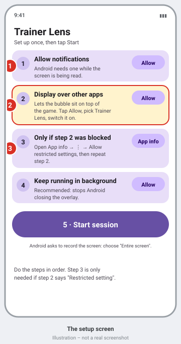
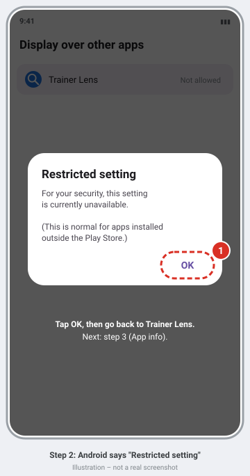
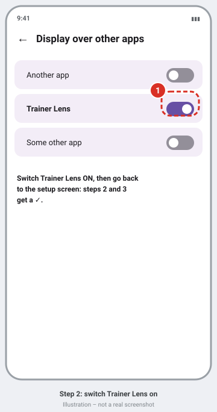
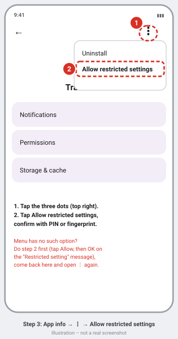
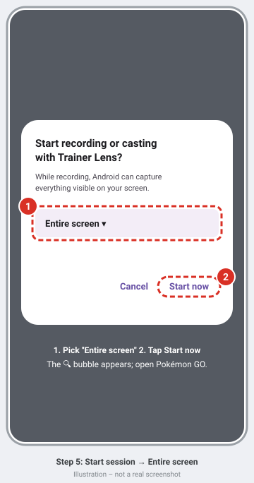
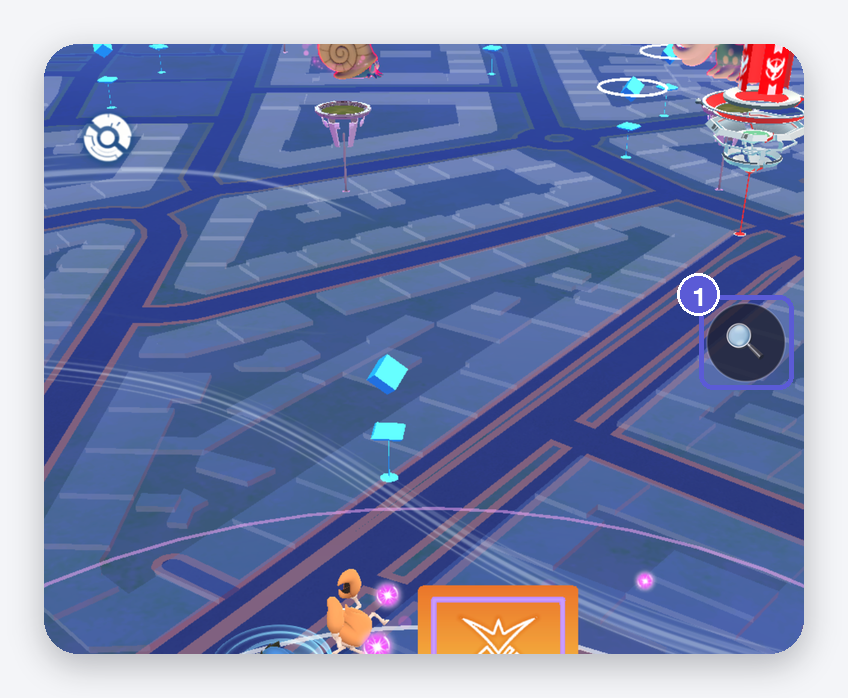
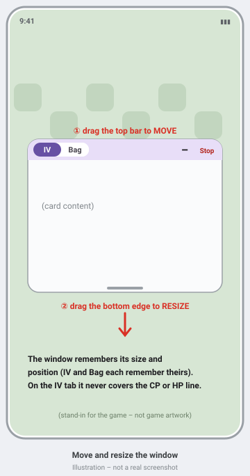
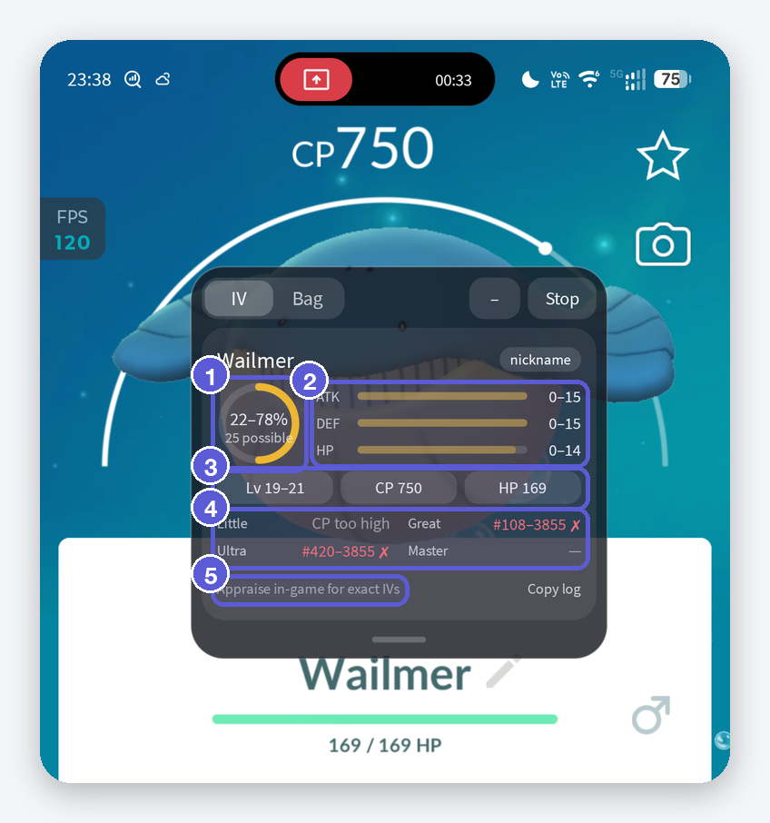
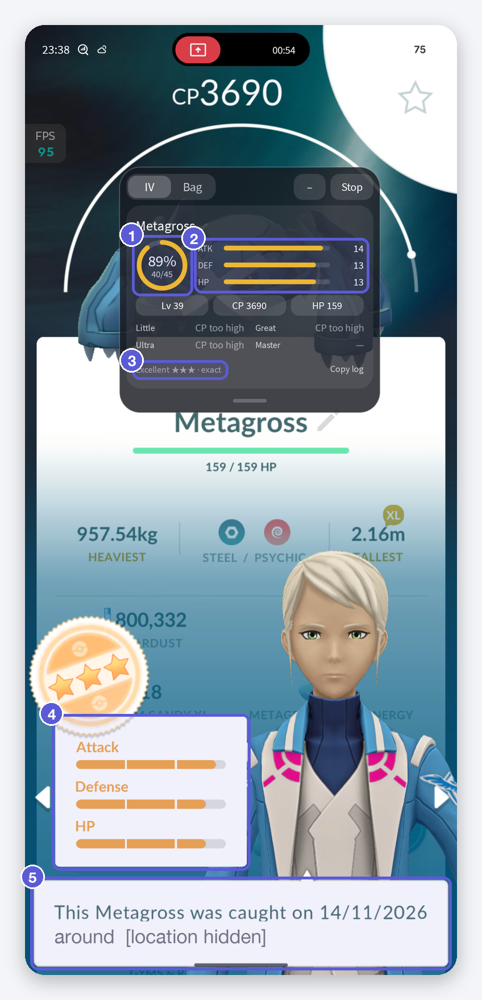
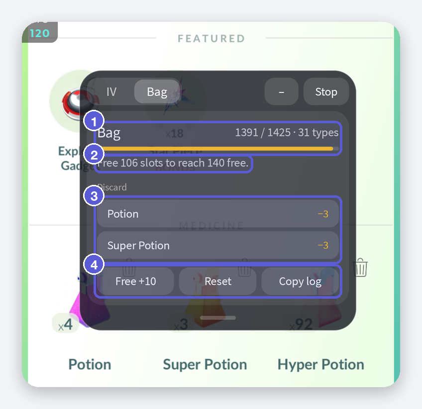

# Trainer Lens – step-by-step walkthrough

For someone who has never used it. Takes about 5 minutes the first time. The pictures of the Android settings screens are **drawn illustrations** (your phone's wording and colours may differ a little). The pictures of the overlay in the game are **real screenshots** with the numbers explained under them; the place in the "caught on" line is hidden.

**You need:** an Android phone (Android 8.0 or newer) with Pokémon GO installed.

---

## Part 1 – Install and set up (once)

### 1. Install the app
1. On your phone, open the [download link](https://github.com/PremKishore27/trainer-lens/releases/latest/download/TrainerLens.apk) and open the downloaded `TrainerLens.apk`.
2. If Android asks, allow your browser (or Files app) to **install unknown apps**.
3. If Google Play Protect appears, tap **Install without scanning**.
4. Open **Trainer Lens**.

### 2. The setup screen
You will see a list of numbered steps. Do them **in order**. A step turns into a **✓** when it is done.

**Step 1 – Allow notifications.** Tap **Allow** → **Allow**. (Android requires one notification while the screen is being read.)

### 3. Step 2 – Display over other apps
Tap **Allow** in step 2, pick **Trainer Lens** in the list and switch it **on**.

**It worked** if the switch turns on – skip to Step 4 below.

**Android shows "Restricted setting"** (or the switch is greyed out)? That is normal on Android 13 and newer for apps installed outside the Play Store. Do this:

1. Tap **OK** and go **back** to Trainer Lens.
2. Do **Step 3** (next section).
3. Come back and do **step 2 again** – now the switch can be turned on.

### 4. Step 3 – Allow restricted settings *(only if step 2 was blocked)*
> **Why this is a separate step:** the menu entry you need appears **only after** Android has blocked step 2 once. If you open the menu before that, the entry is missing. So do step 2 first.

1. In Trainer Lens tap **Open App info** (step 3). The *App info* page of Trainer Lens opens.
2. Tap the **⋮ three dots in the top right corner**.
3. Tap **Allow restricted settings** and confirm with your PIN or fingerprint.
4. Go back to Trainer Lens and tap **Allow** in step 2 again; switch Trainer Lens **on**.

**There is no "Allow restricted settings" in the ⋮ menu?** You have not triggered the block yet. Go back, tap **Allow** in step 2 (you will see *Restricted setting* → **OK**), then open App info → ⋮ again. It is there now.

When step 2 turns **✓**, step 3 shows **Not needed**. That is correct.

### 5. Step 4 – Keep running in the background *(recommended)*
Tap **Allow** → **Allow**. This stops Android from closing the bubble while you play.

### 6. Start session
Tap **5 · Start session**. Android asks to record the screen: pick **Entire screen**, then **Start now**. The app closes itself and a round 🔍 bubble appears. Now open **Pokémon GO**.

> The picture of your screen is read **on your phone** and thrown away at once. Nothing is saved or uploaded. The app never taps or swipes in the game.

---

## Part 2 – Use it in Pokémon GO

### The bubble and the window
- **Drag** the bubble to wherever it bothers you least.
- **Tap** it to open the window. It has two tabs: **IV** and **Bag**.
- **–** shrinks it back to the bubble. **Stop** ends the session (to use it again, open Trainer Lens and tap Start session).

### Move and resize
- Drag the **top bar** to move the window.
- Drag the **thin bar along the bottom edge** up or down to make the window smaller or bigger. It remembers its size and position (the IV and Bag tabs each remember their own).

**Where it may sit.** The app reads the Pokémon's CP (top), HP line (middle) and, during an appraisal, the bars and the "caught on" line (lower part of the screen). The window is blacked out in what the app reads, so it must not cover those:
- it snaps away from the HP line by itself when you let go;
- when you open the **appraisal** in the game, it glides up into the free space under the CP line (and gets smaller if it has to), so the bars and the "caught on" line stay readable. Just wait a second.
- if a card says *Can't read the HP line*, drag the window up or down.

### IV tab – how good is this Pokémon?
1. Tap the bubble, choose the **IV** tab.
2. In the game, open a Pokémon from your Pokémon list (not from the map).
3. Within a second or two the card shows: **IV %**, Attack / Defense / HP, level, and the rank for the **Little / Great / Ultra / Master** leagues.
4. **Keep the window away from the CP line (top) and the HP line (middle).** The app places it in the free space by itself; if you move it onto those lines, the card says *Can't read the HP line* – just drag it up or down.

**How to read it:** a green ring means a great Pokémon (top-100 PvP rank or ≥ 91 %), amber is decent, red is weak. **✓** in a league row = a top-100 spread, **?** = maybe, **✗** = not good, *CP too high* = already above that league's limit.

#### Get the exact IVs (recommended)
Without an appraisal the app estimates and may show a range like *84–96 %*. For the exact numbers:

1. In the game tap **☰ → Appraise** on the Pokémon.
2. Tap through until the **three bars** (Attack, Defense, HP) are on screen and keep them there for about a second.
3. The card now says **exact**.

This also fixes **renamed Pokémon**: the game's "This … was caught on …" line names the Pokémon and the app reads it.

### Bag tab – what can I throw away?
1. Tap the bubble, choose the **Bag** tab.
2. In the game tap the **Poké Ball → Items**.
3. **Scroll slowly** through the *whole* list. The app remembers everything it has seen (*remembered: N item types*). Tip: tap **–** to hide the window while you scroll.
4. Read the window:
   - **Can remove** – items above the keep limit (84 Poké Balls with a limit of 50 → remove 34).
   - **Keep** – everything else. Important items (incense, lures, Lucky Egg, Rare Candy, TMs …) are never suggested.
   - **Bag full?** It lists exactly what to discard to free up space, common items first.
   - **Free more (+10)** aims for 10 more free slots. **Reset** starts the list over.

> The advice is a **suggestion**. Double-check before you discard anything.

---

## When something is off

| You see | Do this |
|---|---|
| Step 2 says **Restricted setting** | Tap OK, do step 3 (App info → ⋮ → Allow restricted settings), then step 2 again. |
| No *Allow restricted settings* in ⋮ | Tap **Allow** in step 2 once (and OK on the message), then open ⋮ again. |
| The bubble vanished | Android stopped the screen reading. Open Trainer Lens → **Start session**. Step 4 helps prevent it. |
| **Check a Pokémon** (IV tab) | Open a Pokémon from your list. |
| **Wrong screen** (IV tab) | You are in the Item bag. Go back and open a Pokémon. |
| **Go to your Item bag** (Bag tab) | Poké Ball → Items. |
| **Can't tell which Pokémon this is** | ☰ → Appraise on that Pokémon. |
| **Can't read the HP line** | Drag the window up or down, or make it smaller. |
| *remembered: 0 item types* | Scroll slower, with the Items list on screen. |

Still stuck? Tap **Copy log** in the window, delete the *"caught on … <place>"* line, and paste it into a [GitHub issue](https://github.com/PremKishore27/trainer-lens/issues/new/choose).
